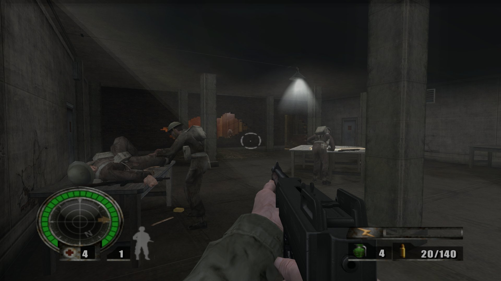
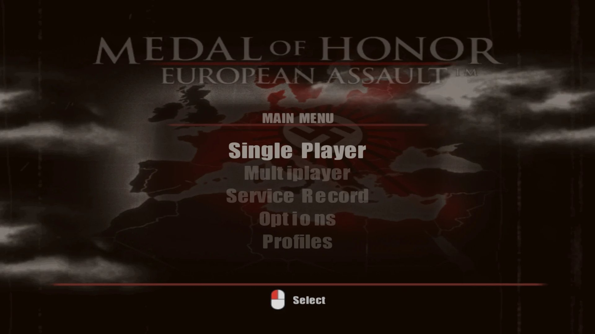
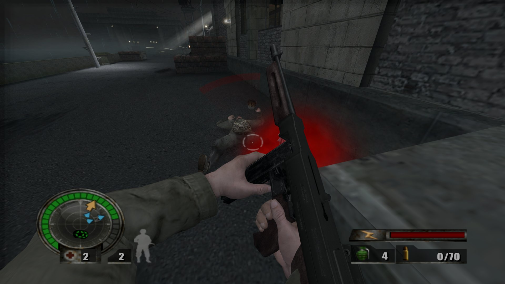
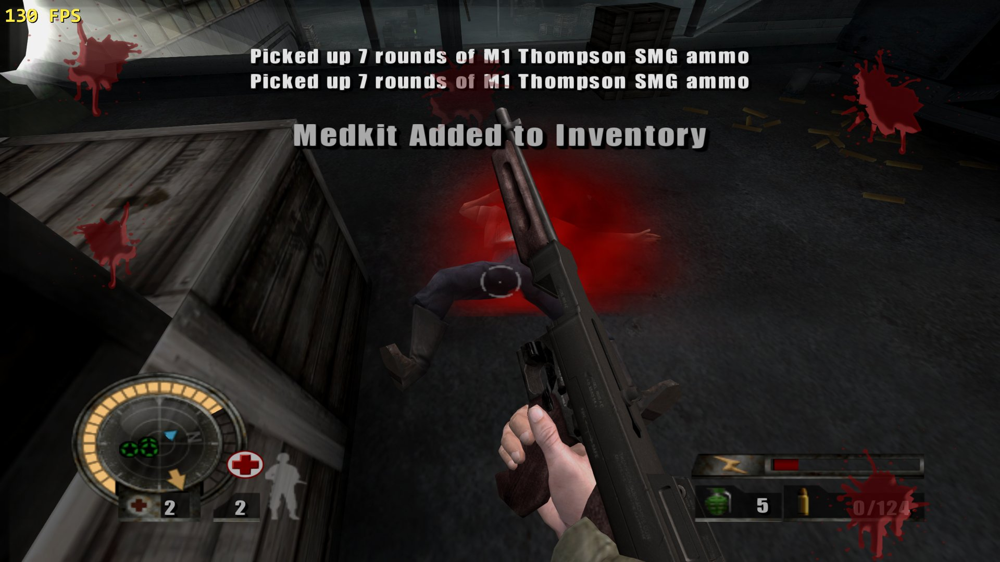
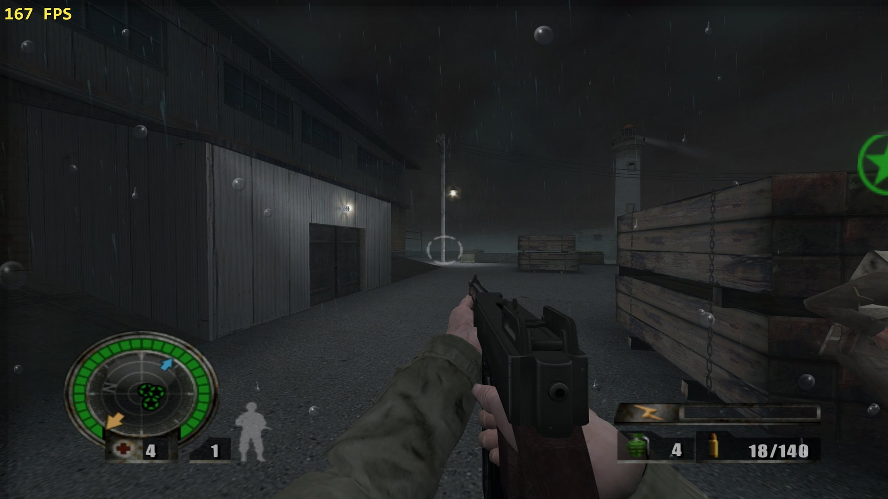
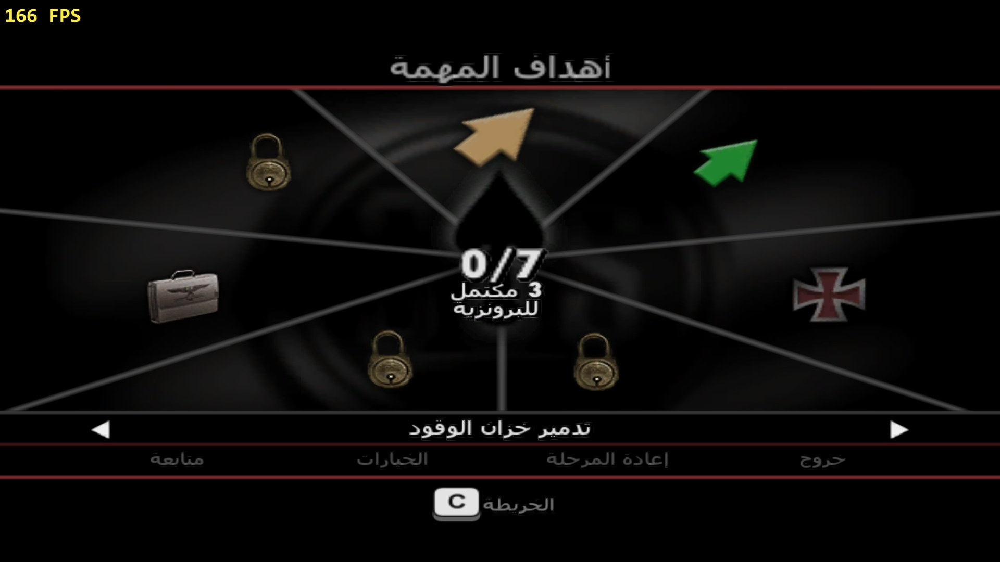
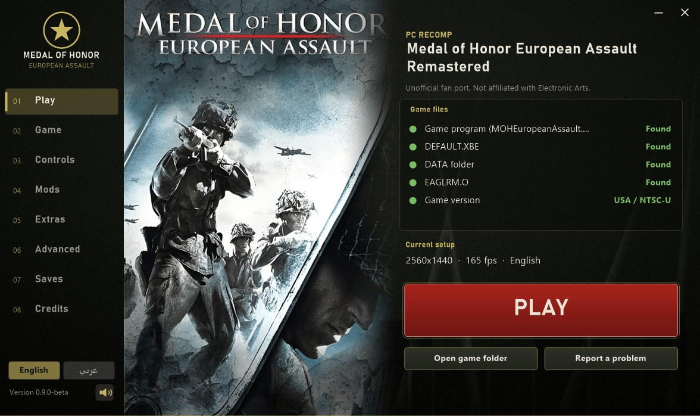
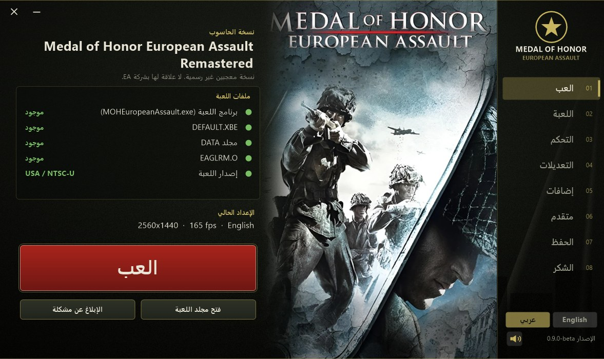

# Medal of Honor: European Assault — PC Port

**Version 0.9.0-beta** · Windows 10/11 64-bit · unofficial fan project, made with [Claude Code](https://claude.com/claude-code)

A native Windows port of *Medal of Honor: European Assault* (Xbox, USA / NTSC‑U), made by **statically
recompiling** the game's own program (`DEFAULT.XBE`) into a PC executable — this is not an emulator, the
game's own code runs as native x86‑64.

> Not affiliated with, endorsed by or sponsored by Electronic Arts. *Medal of Honor* and *European Assault*
> are trademarks of Electronic Arts Inc. **No game data is included in this download — you need your own
> copy of the game.**

**[⬇️ Download the latest release](../../releases/latest)** — see [Install](#install) below.

## Features

Read **[the full development story](PROJECT_STORY.md)** for how each of these was actually built — what
worked, what didn't, and the detours in between.

### Direct3D 11 rendering — widescreen, 4K, wider view, longer draw distance
Native 16:9, any resolution up to 4K, FXAA, anisotropic filtering — plus a field of view and a draw distance
far beyond the Xbox original, both adjustable live.

### Mouse and keyboard with native aim, auto-switching button icons
Native mouse-look (not a converted controller stick), full key rebinding, gamepad with rumble, and on-screen
prompts that switch automatically between keyboard, Xbox and PlayStation glyphs.

<video src="media/feature_controls.mp4" width="85%" controls muted loop playsinline></video>

### Sharper fonts
Every one of the game's 8 fonts (menus, HUD, subtitles) redrawn at a much higher resolution, same layout.

### More blood, on every hit
Blood amount, size and lifetime are adjustable (Normal/More/Lots/Extreme).

### Screen blood, dirt and rain
Optional effects drawn on the screen itself: blood/dirt from a nearby hit or explosion, and rain drops in
St. Nazaire's weather levels.

  
  

### "Super Accuracy" — zero weapon spread, no recoil climb
An optional, honest toggle for players who want a steadier aim.

<video src="media/feature_accuracy.mp4" width="85%" controls muted loop playsinline></video>

### Mod support — textures, sounds, weapon stats
Drop a PNG into `mods\textures`, a WAV into `mods\sounds`, or a text file into `mods\weapons` — no game
files are shipped, every player builds their own from their own copy.

### A full Arabic language pack, mirrored right-to-left menus
Including a fully Arabic, mirrored version of this project's own settings screen.

### A launcher (English + Arabic) with setup checks and presets
Checks your game files and system, performance presets, in-launcher key binding, save backup, update check.

  
  

### In-game "Recomp Settings" menu (F1) and F12 screenshots
Every setting above, changeable without leaving the game.

<video src="media/feature_recompsettings.mp4" width="85%" controls muted loop playsinline></video>

## Please know (current limitations)

- Only the **USA / NTSC‑U** version of the game is supported.
- Only **60 and 90 fps is fully stable**. 120 / 144 / 165 / 240 fps modes exist and mostly work, but are marked
  *unstable* in the launcher and can stutter in busy scenes.
- Sound may **rarely** cut out in very long sessions; a guard restarts it automatically, but if it doesn't,
  please attach `play_log.txt` to an issue.
- Weapon mods: only a weapon's magazine size is confirmed to work; damage, range and fire‑rate keys are
  shipped but **experimental**.
- Sound replacement mods are shipped but **untested end‑to‑end**.
- The Arabic translation is partial; some mission subtitles stay in English or can clip in narrow boxes.
- Full list: [KNOWN_ISSUES.txt](KNOWN_ISSUES.txt).

## Install

1. Download the zip from **[Releases](../../releases/latest)** and unzip it anywhere you can write to
   (not `Program Files`).
2. Put your own copy of the game's files into the **`game`** folder: `game\DEFAULT.XBE`, `game\DATA\...`
   and `game\EAGLRM.O`. If you only have a disc image, unpack it with
   [xdvdfs](https://github.com/antangelo/xdvdfs) or any Xbox ISO extractor.
3. Run **`Launcher.exe`**. The *Play* tab shows green checks once everything is found. Pick your settings
   and press **PLAY**.
4. The very first start (and every new area) compiles shaders — short stutters are normal and go away.

You can also start `MOHEuropeanAssault.exe` directly; it reads the same settings the launcher writes.

## Reporting a problem

Please open an [issue](../../issues/new) (or use the launcher's **Report a problem** button, which opens
this page and the game folder for you) and attach `play_log.txt` (and `play_log_prev.txt`). Say which
Windows version and GPU you have. Windows SmartScreen or an antivirus may warn about the unsigned
executables — that is expected for a small unsigned project, not a sign of a problem.

## Credits

- *Medal of Honor: European Assault* © Electronic Arts. No EA game assets, other than files you supply
  yourself, are included in this repository or its release downloads.
- **[xboxrecomp](https://github.com/sp00nznet/xboxrecomp)** by sp00nz (MIT) — the static‑recompilation
  toolkit this whole project is built on.
- **[xemu](https://github.com/xemu-project/xemu)** (LGPL‑2.1+; espes, Jannik Vogel, Matt Borgerson and
  contributors) — the original‑Xbox audio/graphics chip emulation this port's sound and video code is
  derived from. Source of the derived files: see [SOURCE.txt](SOURCE.txt).
- **[xdvdfs](https://github.com/antangelo/xdvdfs)** by antangelo — unpacking the Xbox disc image.
- **[vgmstream](https://github.com/vgmstream/vgmstream)** — used as a development/verification tool only.
- Written and debugged together with **[Claude Code](https://claude.com/claude-code)** (Anthropic), which
  wrote and reverse‑engineered most of this port's code interactively with the author.
- Microsoft DirectX 11, XAudio2, GDI+.

## License

Free to use for personal, non‑commercial purposes, provided unchanged and with all credits intact. See
[LICENSE.txt](LICENSE.txt); the LGPL‑covered parts are listed in [SOURCE.txt](SOURCE.txt).

---

# بالعربية

# ميدل أوف أونر: يوروبيان أسولت — نسخة الحاسوب

**الإصدار 0.9.0-beta** · ويندوز 10/11 (64 بت) · مشروع معجبين غير رسمي، بمساعدة [Claude Code](https://claude.com/claude-code)

نسخة أصلية لويندوز من لعبة *Medal of Honor: European Assault* (إكس بوكس، النسخة الأمريكية NTSC-U)، صُنعت
بإعادة ترجمة برنامج اللعبة نفسه (`DEFAULT.XBE`) إلى تنفيذي يعمل على الحاسوب مباشرة — **هذه ليست محاكياً**،
كود اللعبة نفسه يعمل كـ x86-64 أصلي.

> المشروع غير مرتبط بشركة Electronic Arts ولا برعايتها. *Medal of Honor* و *European Assault* علامتان
> تجاريتان لشركة Electronic Arts. **لا تحتوي هذه الحزمة على أي ملفات من اللعبة — تحتاج نسختك الخاصة.**

**[⬇️ تحميل آخر إصدار](../../releases/latest)**

## الميزات

اقرأ **[قصة تطوير المشروع كاملة](PROJECT_STORY.md)** (بالإنجليزية حالياً) لمعرفة كيف بُنيت كل ميزة.

### رسم Direct3D 11 — شاشة عريضة، 4K، مجال رؤية ومسافة رسم أكبر

### ماوس وكيبورد بتصويب أصلي، أيقونات أزرار تتبدل تلقائياً

<video src="media/feature_controls.mp4" width="85%" controls muted loop playsinline></video>

### خطوط أوضح لكل النصوص

### دم أكثر، على كل إصابة

### دم وغبار ومطر على الشاشة نفسها

  
  

### دقة عالية بلا ارتداد أو تشتت رصاص "Super Accuracy"

<video src="media/feature_accuracy.mp4" width="85%" controls muted loop playsinline></video>

### دعم التعديلات — خامات، أصوات، إحصائيات الأسلحة
استبدال أي خامة من `mods\textures`، أو صوت من `mods\sounds`، أو تعديل إحصائيات سلاح بملف نصي في
`mods\weapons` — لا تُشحن أي ملفات من اللعبة، كل لاعب يصنع ملفاته من نسخته الخاصة.

### حزمة لغة عربية كاملة تجريبياً بقوائم من اليمين لليسار

### مشغّل (لانشر) عربي/إنجليزي بفحص الملفات وإعدادات جاهزة

  
  

### قائمة "Recomp Settings" داخل اللعبة (F1) ولقطة شاشة بـ F12

<video src="media/feature_recompsettings.mp4" width="85%" controls muted loop playsinline></video>

## معلومات مهمة

النسخة الأمريكية فقط مدعومة — 60 إطاراً/ثانية فقط مستقرة بالكامل (الأعلى تجريبي) — قد يختفي الصوت نادراً في
جلسات طويلة (يُعاد تشغيله تلقائياً) — تعديلات الأسلحة والأصوات تجريبية جزئياً — الترجمة العربية جزئية. القائمة
الكاملة: [KNOWN_ISSUES.txt](KNOWN_ISSUES.txt).

## التثبيت

1. نزّل الملف المضغوط من [الإصدارات](../../releases/latest) وفكّ ضغطه في مجلد تقدر الكتابة فيه.
2. ضع ملفات لعبتك الخاصة في مجلد `game` (`DEFAULT.XBE` و`DATA` و`EAGLRM.O`).
3. شغّل `Launcher.exe`، اضبط إعداداتك، واضغط **PLAY**.

## الإبلاغ عن مشكلة

افتح [تذكرة جديدة](../../issues/new) أو استخدم زر **Report a problem** في اللانشر، وأرفق `play_log.txt`.

## الشكر والترخيص

انظر الأقسام الإنجليزية أعلاه (Credits / License) — نفس الشكر والترخيص يسريان على النسخة العربية من هذا
المشروع.
