# Medal of Honor: European Assault — PC Port

**Version 0.9.3-beta** · Windows 10/11 64-bit · unofficial fan project, made with [Claude Code](https://claude.com/claude-code)

A native Windows port of *Medal of Honor: European Assault* (Xbox), made by **statically
recompiling** the game's own program (`DEFAULT.XBE`) into a PC executable — this is not an emulator, the
game's own code runs as native x86‑64.

> Not affiliated with, endorsed by or sponsored by Electronic Arts. *Medal of Honor* and *European Assault*
> are trademarks of Electronic Arts Inc. **No game data is included in this download — you need your own
> copy of the game.**

**[⬇️ Download the latest release](../../releases/latest)** — see [Install](#install) below.

## What's new in 0.9.3-beta

The biggest release so far: a **map editor**, a new **weapon lighting** system, blood stains, an ultrawide view, a free
camera, many gameplay options and tools to find crashes.

> ⚠️ **The Map editor is EXPERIMENTAL.** It is off by default and still in testing. It may show bugs, and in rare cases it
> can crash or freeze the game, especially with many placed soldiers or when changing levels. Your edits are saved per level
> in `mods\maps\`; if a level misbehaves, turn the editor off or delete that level's file. Please report problems on
> GitHub Issues with `play_log.txt` and `crash.txt`.

### Map editor (experimental)

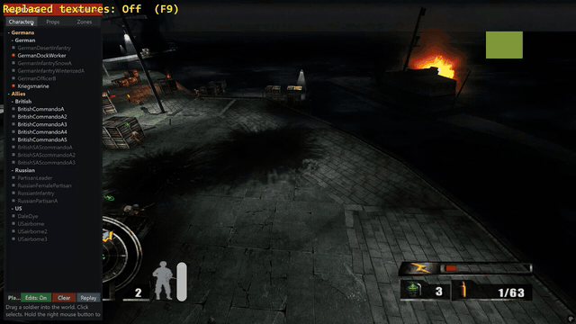 <a href="media/m093_mapeditor.mp4">full-quality video</a>

Turn it on in Recomp Settings (F1) > Mods and tools > Map editor, press **Insert** for the free camera, then **Numpad 0** for
the editor window.

- **Characters:** drag any German or Allied soldier type into the world. It lands where the mouse points, on the floor or on top
  of a crate. A translucent stand-in shape follows the mouse while you drag.
- **Props:** drag the pickups the level knows (medkit, ammo, documents, the level's weapons). They glow and can be picked up.
- **Zones:** your own spawn zones. Pick a soldier type, set soldiers per wave, radius, waves and wake distance, then drag "New
  zone" into the world. Soldiers are born inside the ring and walk around in it; the next wave comes after you leave and come back.
- **Delete:** a short right click removes the soldier, prop or zone under the pointer (hold the button to look around).
- Placed soldiers stay where you drop them and still fight, take cover and throw grenades. Up to 16 living editor soldiers.
- Everything is saved per mission in `mods\maps\<level>.txt` and comes back at mission start and after a restart. The
  **Edits: On/Off** button starts a level as the game made it without deleting your file.

*Known limits:* 16 living soldiers at most; no prop rotation; no weapons from other levels; zones cannot be edited after
placing; rings show through walls; soldiers can be born inside crates; the drag preview is a shape, not the real model; the
level's own pickups cannot be removed; window text is English only; not in the launcher yet.

### Weapon lighting

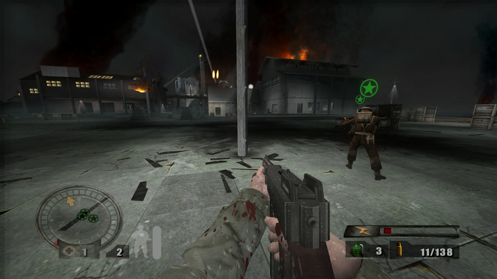 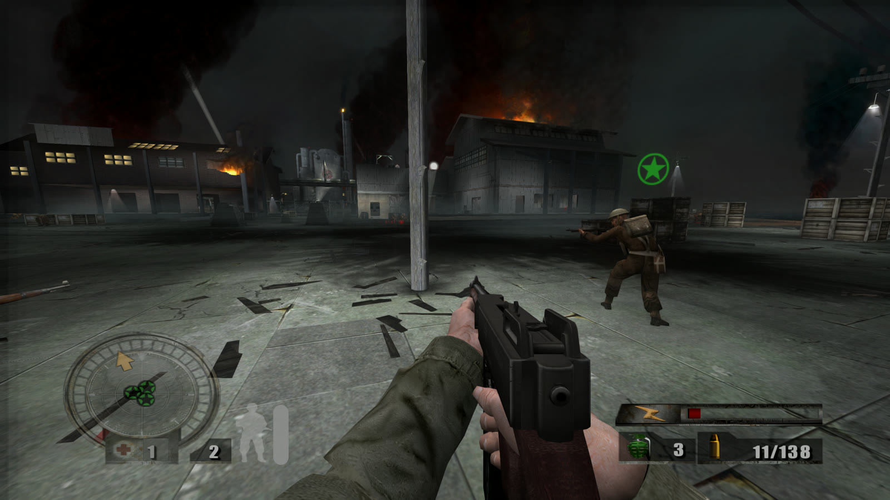 Left: on (rain and blood on the gun and hands). Right: off.

Recomp Settings (F1) > Effects > **Weapon lighting**: Off / Low / Normal / High / Extreme. The gun and hands get directional
light and reflections from the scene (a lamp on your right lights the right side of the gun), plus dust after explosions,
blood splatters when you are hurt and animated rain drops. No fps cost: only the weapon's own pixels are touched.

### Blood stains

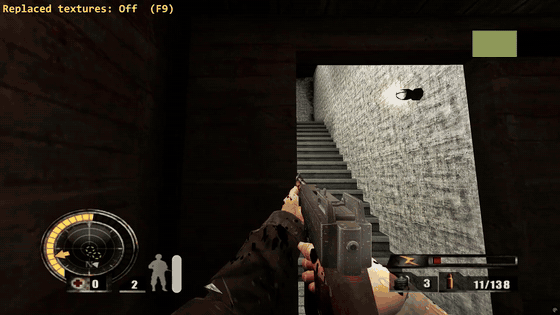 <a href="media/m093_blood_stains.mp4">full-quality video</a>

Hits leave blood on walls and floors, deaths leave a pool. Drawn from your own blood pictures, tinted by the Blood colour
setting, in every level. F1 > Effects > **Blood stains** (Off / Low / Normal / High) and **Stain limit**.

### Weapon feel

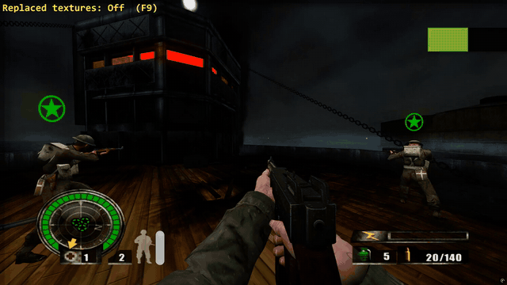 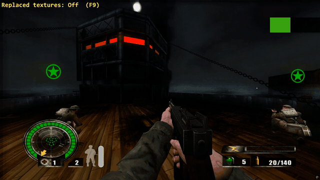 Gun sway: off (left), on (right). Strength 1 to 5.

The weapon has weight: when you turn the camera it lags behind and catches up with a small swing.

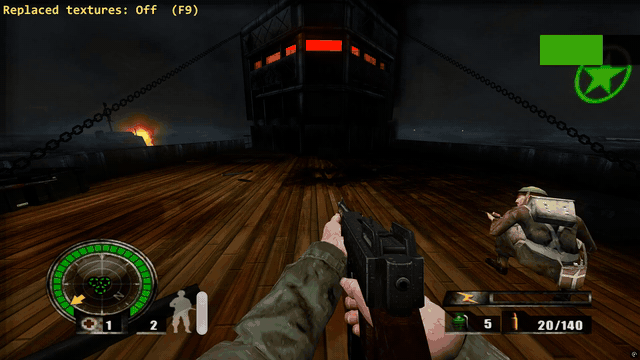 <a href="media/m093_sprint_pose.mp4">full-quality video</a>

**Sprint pose:** while sprinting the weapon is carried across the body and swings with your steps. Firing or aiming brings it
back at once.

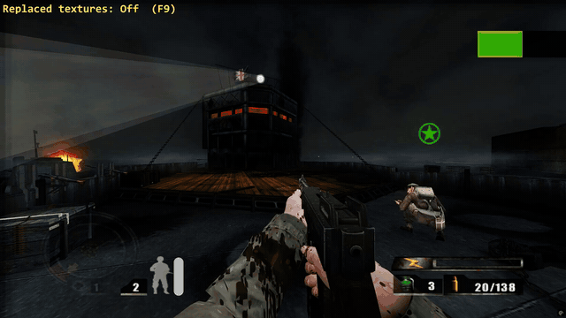 <a href="media/m093_scope_sway.mp4">full-quality video</a>

**Scope sway:** under a quarter of your health, the aim in a scope moves in a slow wave.

### Hit marker and explosions

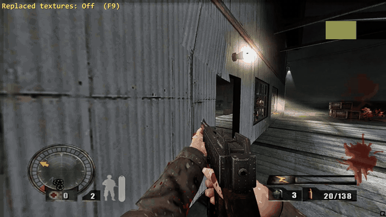 A white X when you hit an enemy, a red X when you kill him. <a href="media/m093_hit_marker.mp4">full-quality video</a>

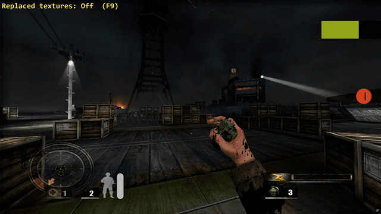 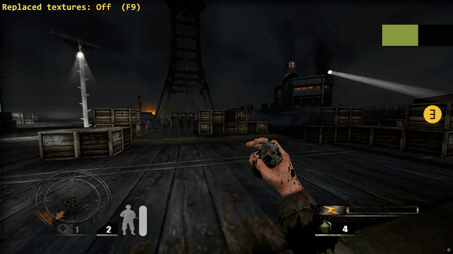 Explosion size: Normal (left), x4 (right). Options: Normal / x1.5 / x2 / x3 / x4. Damage and radius are unchanged.

### Free camera

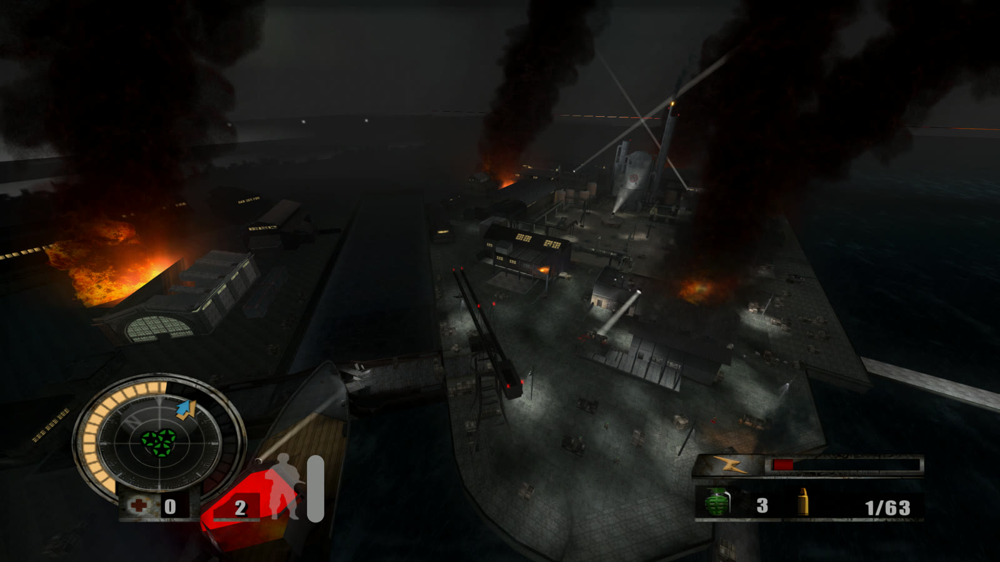

Press **Insert** in a mission to leave the soldier and fly anywhere (W A S D, mouse, Space / C up and down, Shift faster,
Ctrl slower). The world stands still by default, or keeps running if you choose.

### More new things

- **Enemy grenades:** enemies who shoot at you now throw grenades (Gameplay > Enemy grenades: Low / Medium / High). The original
  game never made enemies throw them in the levels we tried.
- **Ultrawide:** F1 > Video > **Aspect ratio** (4:3 / 16:9 / 21:9 / Auto, restart). The view grows sideways, the HUD goes to
  the screen edges, menus stay 16:9.
- **Damage mode** (Normal / Low damage): pistols and machine guns need 7 hits to kill, heavy rifles one head shot or two body shots.
- **Cheats tab** (launcher and F1): unlimited ammo, invincible, suicide, unlock all missions (your save is not changed), super
  accuracy, squad mates (Normal / Tough / Weak).
- **Auto switch weapon:** Off / Empty magazine / Out of ammo.
- **Grenade macro:** hold the grenade control to take it out and pull the pin, release to throw; your gun comes back after.
- **Mouse wheel = change weapon** (in a scope it still zooms).
- **Pain sounds and breathing** with your own WAV files in `mods\sounds\`, no fps cost.
- **HUD:** a vertical stamina bar, a fourth RUN icon, sharper stance icons, 5 gamepad icon styles (Xbox, Xbox 360, PS2/PS3,
  PS4, PS5), and 17+ HUD elements you can hide one by one.
- **Stereo sound** (Audio): Original or Mono. *If a sound seems to fade or vanish when you turn to one side, switch it to Mono.*
- **Heavy rifle aiming fix** (Gewehr, M1 Garand, scoped rifles and others) at high fps.
- **Texture mods:** BC7, BC4 and BC5 DDS files now work.
- **F1 menu** reorganised into categories, movable and resizable; the mouse wheel scrolls it.
- **Menus with the mouse:** the campaign and mission map screens now follow the pointer; the wheel zooms the first scope of a level.
- **Fixed:** stutter on entering a level with very large texture packs; a crash when entering a new level; dead bodies flung in
  the air at high fps (optional **Corpse fix (60 Hz physics)**, off by default, it can freeze the game).

### Help us find crashes

- If the game crashes, open a GitHub issue and attach `crash.txt`, `crash.dmp` and `play_log.txt` from the game folder. Say how
  long you had been playing and whether you use overlays (RTSS, Discord, Steam, ReShade).
- The launcher's **Report a problem** button now builds `MoH_report.zip` for you (logs, ini, system info; your Windows user name
  is removed).
- If parts of the ground turn pure black, press **F2** while it is black and attach `play_log.txt` and the screenshot.

### Ideas for later versions (not promised)

Things we want to try. None has a date and some may turn out impossible:

- Weapons from other levels placed by the editor (the BAR of the first levels is the hardest case).
- More editor objects (crates, barrels, vehicles, mounted guns), prop rotation, editing a zone after placing it.
- Soldiers that really use the game's cover.
- Higher-detail character models.
- The editor in the launcher and in Arabic.

Multiplayer reminder: local split-screen works. There is no online or LAN play, no bots and no campaign co-op: the original game
has no network code.

## What's new in 0.9.2-beta

A small fix release for three things players reported:

- **Karabiner 98k now hits through the scope too.** 0.9.1 fixed hip fire; with the scope up the bullet still left the
  barrel off the crosshair at high frame rates. Scoped shots now follow the camera exactly, like hip fire.
- **Mouse wheel zooms the sniper scope.** While a scope is up, wheel up/down zooms in/out through the game's own zoom
  steps, the same as the arrow keys and the pad's D-pad (those still work).
- **Automatic fire speed** (new row in Recomp Settings and in the launcher): at 60 fps and above the MP40 and other
  automatic weapons fired about 1.6 times faster than the game was played at 30 fps. Choose **Fast** (the game's own
  speed at your frame rate), **Normal** (the 30 fps pace, the new default), **Slow** or **Slowest**. It only touches
  automatic weapons, never the Karabiner or pistols. Known limit: the game fires its bullets in pairs, so the pace is
  per pair.

## What's new in 0.9.1-beta

### Faster — measured, same PC, same settings

A/B test of the 0.9.0-beta executable against this one (RTX 4060, 165 Hz cap, same level, same route):

| | 0.9.0-beta | 0.9.1-beta | change |
|---|---|---|---|
| Median frame rate | 131 fps | **161 fps** | +23% |
| Slowest 10% of the time | 89 fps | **145 fps** | **+63%** |
| Median 1% low | 94 fps | **107 fps** | +14% |

In the heaviest places of the author's test (where 0.9.0 dipped to 80–125 fps) the new build stays above 150.
Gains depend on your PC; the busiest scenes gain the most. What changed inside:

- The whole game code is built with **profile-guided optimisation**, trained on real play.
- The cached **register and memory base addresses** are loaded once per function instead of before almost every memory
  access, in all 21,741 recompiled functions.
- The **game thread gets priority** in the emulated CPU lock: a worker no longer holds it for milliseconds (waits fell
  from 5–6 ms to under 1 ms per frame).
- Environment-variable lookups answered from a per-thread cache (they were hit on every frame).
- A **hitch watchdog** and a per-second `[FRAMES]` line in `play_log.txt` (frame times, lock waits) so a stutter can be
  traced from a bug report.
- The developer diagnostics (AI probes, shot and projectile logs, aim measurement) are **compiled out** of the player
  build, so they cannot cost a frame.

### Gameplay fixes

- **Karabiner 98k (and the whole fast-rifle class) now hits what the crosshair is on at 60 fps and above.** At high
  frame rates the game dropped the camera-kick term from the bullet's direction, so the bullet left about 2° too high
  and passed over enemies at range, while at 30 fps it was fine. The direction is now the same at every frame rate.
  It applies to the player's bullets with a fast muzzle speed (the Karabiner and rifles that share its class), not
  to machine guns or pistols. `RECOMP_AIM_FIX=0` turns it off.
- **Weapon mods:** the scanner no longer reads `mods\weapons\README.txt` as if it were a weapon file.
- **Grenade timer** (new, on by default, switchable): a small circle at the side of the screen counts down the seconds
  from the moment a grenade's pin is pulled or it is thrown.

### New options (in the launcher and in the in-game Recomp Settings, English and Arabic)

- **Enemy count (heavy, experimental)** — x2 to x5 times the enemies that spawn points create (reinforcements and
  respawns). Takes effect at the next mission load, can cost frames, and can be turned on or off **per difficulty**
  (Recruit, Veteran, Elite, Hero) with four extra switches.
- **Stamina bar** — a yellow sprint bar above the adrenaline meter that drains while you run; when it is empty you
  return to walking speed and it refills after a few seconds. Sprint speed, duration and recovery time are options.
- **Blood colour** — Original / Crimson (the new default) / Dark red / **Custom** with Hue, Saturation and Brightness
  rows and a colour square. The on-screen splatters keep their own colour.
- **Model detail** (level of detail for every model by distance): Game (the original) / Higher / Highest. Higher and
  Highest draw the better models farther away, so they can cost frames.
- **Replaced textures** — On/Off **while playing**, to compare the game's pictures with yours instantly. Press **F9** to switch it without opening the menu.
- **Dump textures** is now Off / PNG / **DDS**. DDS replacements are read by the port itself (uncompressed 24/32-bit
  and DXT1/3/5, old or DX10 header).
- **Rain master switch** — *Rain* (default **Off**); while it is off, the other four rain rows stay visible but greyed
  out. With it on, the default strength is Normal. Fog stays as the game has it.
- **Screen rain** default is now Off in the shipped settings.
- **Split-screen pads (experimental, local multiplayer)** — with it on, the keyboard and mouse control player 1 alone and
  each gamepad drives the next player (game ports 2 to 4), so the game's own multiplayer menu can be used on one PC.
  Not yet verified that every mode then shows a split view; there is no online or LAN play (the original has no
  network code). Off by default; takes effect after a restart.
- **Keep corpses (experimental, off)** — bodies stay on the ground. Soldiers may freeze or respawn doubled with it on.

### In-game menu and files

- **F1 opens Recomp Settings during play** and the game keeps running behind it. The panel is a window (62% × 78% of the
  game window) instead of a full-screen takeover; F1 or gamepad Y reopens it at once after closing. The pause menu is
  untouched. While the panel is up the game gets no input, and held keys are released when it closes.
- **Saves and the Xbox partition images now live in `xboxdata\`** next to the game instead of 4–5 GB of sparse files
  under `%LOCALAPPDATA%\xboxrecomp`. Old saves are copied over once (the old folder is left alone).
- The **menu language** of Recomp Settings follows the game language (English / Arabic).

### AI and difficulty tuning (text files, no game files)

- **`mods\ai\tuning.txt`**: per-difficulty **player max health**, **revives** (medkits) and **enemy damage**
  (`MaxHealth.Recruit/Veteran/Elite/Hero`, `Revives.*`, `EnemyDamage`), plus `EnemyCount`. See `mods\ai\README.txt`.
- **`mods\ai\defs.txt`**: override or scale any of the game's named float / int definition fields by name (CRC32 of
  the name) or hash, optionally for one call site only.
- Research notes shipped in the README of that folder: in this game the difficulty setting changes **only the player**
  (health 400/200/100/50, revives 2/1/0/0); enemy accuracy, reaction time and sight range are **not** exposed there.

### Open source

- The port's **source code is published** in [`source/`](source/) under the MIT licence: the port code, the launcher,
  the in-game settings screen, the tools used to find things in the game, and the xboxrecomp toolkit with this port's
  changes. The recompiled game code itself (machine-translated EA code) is not included; `gen_hand_edits.txt` lists every
  hand edit made in it. See [source/README.md](source/README.md).

### Other

- The launcher shows version 0.9.2-beta and compares itself with the newest GitHub release.
- The shipped `recomp_settings.ini` defaults: rain off, everything else as before.

## Features

Read **[the full development story](PROJECT_STORY.md)** for how each of these was actually built — what
worked, what didn't, and the detours in between.

### Direct3D 11 rendering — widescreen, 4K, wider view, longer draw distance
Native 16:9, any resolution up to 4K, FXAA, anisotropic filtering — plus a field of view and a draw distance
far beyond the Xbox original, both adjustable live.

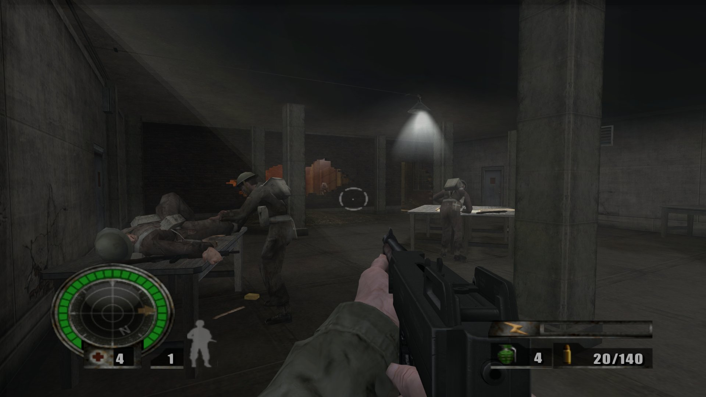

### Mouse and keyboard with native aim, auto-switching button icons
Native mouse-look (not a converted controller stick), full key rebinding, gamepad with rumble, and on-screen
prompts that switch automatically between keyboard, Xbox and PlayStation glyphs.

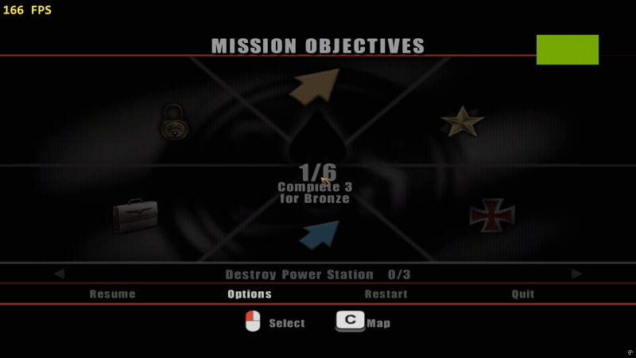 <a href="media/feature_controls.mp4">full-quality video</a>

### Sharper fonts
Every one of the game's 8 fonts (menus, HUD, subtitles) redrawn at a much higher resolution, same layout.

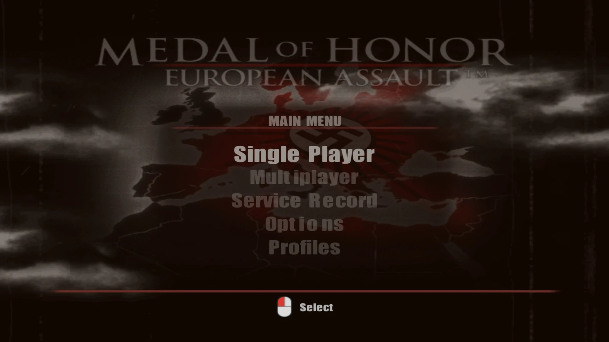

### More blood, on every hit
Blood amount, size and lifetime are adjustable (Normal/More/Lots/Extreme).

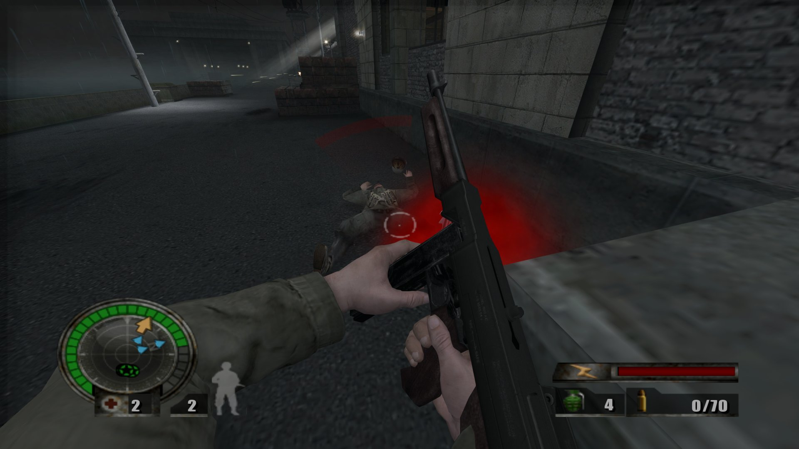

### Screen blood, dirt and rain
Optional effects drawn on the screen itself: blood/dirt from a nearby hit or explosion, and rain drops in
St. Nazaire's weather levels.

  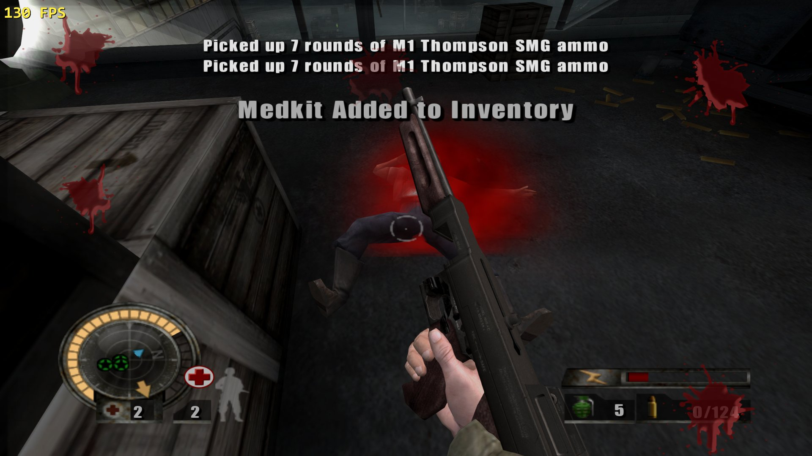
  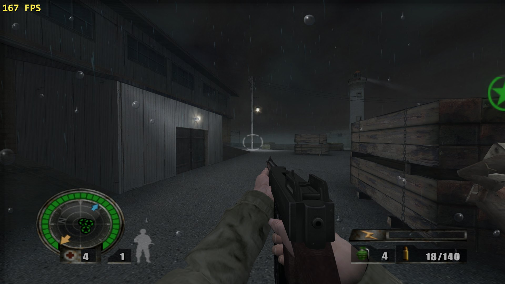

### "Super Accuracy" — zero weapon spread, no recoil climb
An optional, honest toggle for players who want a steadier aim.

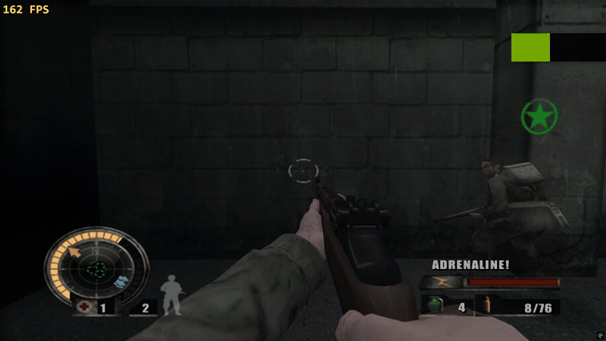 <a href="media/feature_accuracy.mp4">full-quality video</a>

### Mod support — textures, sounds, weapon stats
Drop a PNG into `mods\textures`, a WAV into `mods\sounds`, or a text file into `mods\weapons` — no game
files are shipped, every player builds their own from their own copy.

### A full Arabic language pack, mirrored right-to-left menus
Including a fully Arabic, mirrored version of this project's own settings screen.

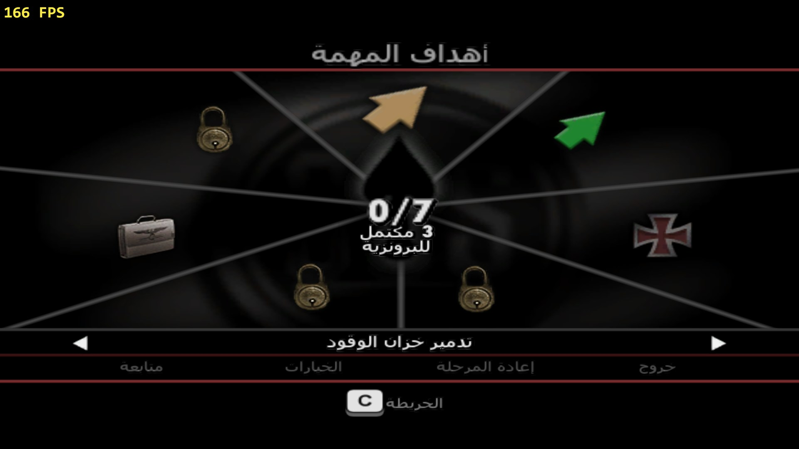

### A launcher (English + Arabic) with setup checks and presets
Checks your game files and system, performance presets, in-launcher key binding, save backup, update check.

  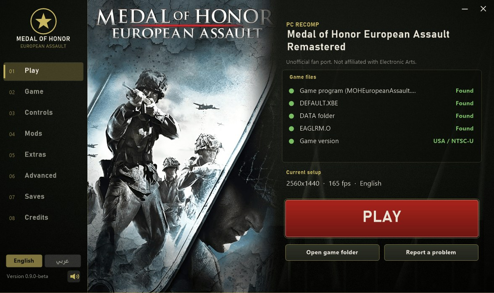
  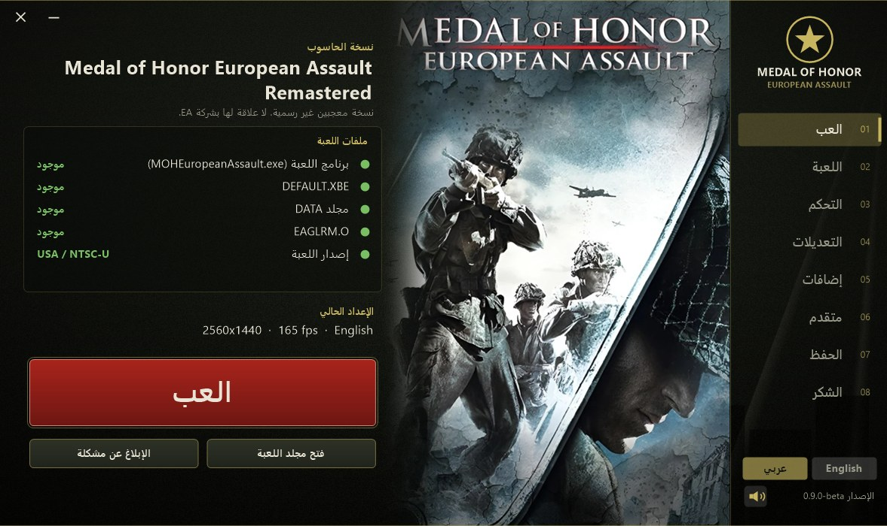

### In-game "Recomp Settings" menu (F1) and F12 screenshots
Every setting above, changeable without leaving the game.

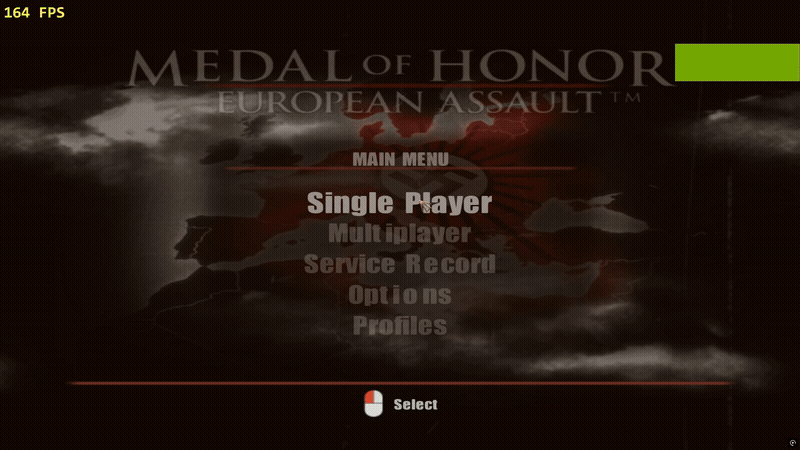 <a href="media/feature_recompsettings.mp4">full-quality video</a>

## Please know (current limitations)

- Both the **USA** and the **European** versions of the game work.
- 60 to 165 fps now run well on the author's PC (RTX 4060); 240 fps and weaker PCs may still stutter in busy scenes. If
  a mode stutters for you, pick a lower one and send `play_log.txt` (it holds frame-time lines).
- Sound may **rarely** cut out in very long sessions; a guard restarts it automatically, but if it doesn't,
  please attach `play_log.txt` to an issue.
- Weapon mods: only a weapon's magazine size is confirmed to work; damage, range and fire-rate keys are
  shipped but **experimental**. Enemy count (x2 to x5) is experimental and heavy: it can cost frames.
- Sound replacement mods are shipped but **untested end‑to‑end**.
- The Arabic translation is partial; some mission subtitles stay in English or can clip in narrow boxes.
- Full list: [KNOWN_ISSUES.txt](KNOWN_ISSUES.txt).

## Install

1. Download the zip from **[Releases](../../releases/latest)** and unzip it anywhere you can write to
   (not `Program Files`).
2. Put your own copy of the game's files into the **`game`** folder: `game\DEFAULT.XBE`, `game\DATA\...`
   and `game\EAGLRM.O`. If you only have a disc image, unpack it with
   [xdvdfs](https://github.com/antangelo/xdvdfs) or any Xbox ISO extractor.
3. Run **`Launcher.exe`**. The *Play* tab shows green checks once everything is found. Pick your settings
   and press **PLAY**.
4. The very first start (and every new area) compiles shaders — short stutters are normal and go away.

You can also start `MOHEuropeanAssault.exe` directly; it reads the same settings the launcher writes.

## Reporting a problem

Please open an [issue](../../issues/new) (or use the launcher's **Report a problem** button, which opens
this page and the game folder for you) and attach `play_log.txt` (and `play_log_prev.txt`). Say which
Windows version and GPU you have. Windows SmartScreen or an antivirus may warn about the unsigned
executables — that is expected for a small unsigned project, not a sign of a problem.

## Credits

- *Medal of Honor: European Assault* © Electronic Arts. No EA game assets, other than files you supply
  yourself, are included in this repository or its release downloads.
- **[xboxrecomp](https://github.com/sp00nznet/xboxrecomp)** by sp00nz (MIT) — the static‑recompilation
  toolkit this whole project is built on.
- **[xemu](https://github.com/xemu-project/xemu)** (LGPL‑2.1+; espes, Jannik Vogel, Matt Borgerson and
  contributors) — the original‑Xbox audio/graphics chip emulation this port's sound and video code is
  derived from. Source of the derived files: see [SOURCE.txt](SOURCE.txt).
- **[xdvdfs](https://github.com/antangelo/xdvdfs)** by antangelo — unpacking the Xbox disc image.
- **[vgmstream](https://github.com/vgmstream/vgmstream)** — used as a development/verification tool only.
- Written and debugged together with **[Claude Code](https://claude.com/claude-code)** (Anthropic), which
  wrote and reverse‑engineered most of this port's code interactively with the author.
- Microsoft DirectX 11, XAudio2, GDI+.

## License

The **source code** ([`source/`](source/)) is under the MIT licence ([source/LICENSE-PORT.txt](source/LICENSE-PORT.txt)); the
download package is free for personal, non-commercial use, shared unchanged and with all credits (see
[LICENSE.txt](LICENSE.txt)). The LGPL-covered parts are listed in [SOURCE.txt](SOURCE.txt). The recompiled game code is
not published.

---

# بالعربية

# ميدل أوف أونر: يوروبيان أسولت — نسخة الحاسوب

**الإصدار 0.9.3-beta** · ويندوز 10/11 (64 بت) · مشروع معجبين غير رسمي، بمساعدة [Claude Code](https://claude.com/claude-code)

نسخة أصلية لويندوز من لعبة *Medal of Honor: European Assault* (إكس بوكس)، صُنعت
بإعادة ترجمة برنامج اللعبة نفسه (`DEFAULT.XBE`) إلى تنفيذي يعمل على الحاسوب مباشرة — **هذه ليست محاكياً**،
كود اللعبة نفسه يعمل كـ x86-64 أصلي.

> المشروع غير مرتبط بشركة Electronic Arts ولا برعايتها. *Medal of Honor* و *European Assault* علامتان
> تجاريتان لشركة Electronic Arts. **لا تحتوي هذه الحزمة على أي ملفات من اللعبة — تحتاج نسختك الخاصة.**

**[⬇️ تحميل آخر إصدار](../../releases/latest)**

## الجديد في 0.9.3-beta

أكبر إصدار حتى الآن: **محرر خرائط**، ونظام **إضاءة للسلاح**، وآثار دم، ودعم الشاشة العريضة جداً، وكاميرا حرة، وخيارات لعب كثيرة،
وأدوات للعثور على أسباب الكراش.

> ⚠️ **محرر الخرائط تجريبي.** مطفأ افتراضياً وما زال قيد الاختبار. ممكن تواجه أخطاء، وفي حالات نادرة قد يكرش اللعبة أو يجمّدها،
> خاصة مع عدد كبير من الجنود أو عند تبديل المراحل. تعديلاتك محفوظة لكل مرحلة في `mods\maps\`؛ إذا تعطلت مرحلة أطفئ المحرر أو
> احذف ملفها. أبلغ عن المشاكل في GitHub Issues مع `play_log.txt` و`crash.txt`.

### محرر الخرائط (تجريبي)

 <a href="media/m093_mapeditor.mp4">الفيديو بجودة كاملة</a>

فعّله من F1 > Mods and tools > Map editor، ثم اضغط **Insert** للكاميرا الحرة، ثم **Numpad 0** لنافذة المحرر.

- **الشخصيات:** اسحب أي نوع جندي ألماني أو حليف إلى العالم. يهبط حيث يشير الماوس، على الأرض أو فوق صندوق. شكل شفاف يتبع الماوس أثناء السحب.
- **الأغراض:** اسحب الأغراض التي تعرفها المرحلة (حقيبة طبية، ذخيرة، وثائق، أسلحة المرحلة). تتوهج ويمكن التقاطها.
- **المناطق (Zones):** مناطق ولادة من صنعك. اختر نوع الجندي، وعدد الجنود في الموجة، ونصف القطر، وعدد الموجات، ومسافة الاستيقاظ، ثم
  اسحب "New zone" إلى العالم. يولد الجنود داخل الحلقة ويتجولون فيها، وتأتي الموجة التالية بعد أن تبتعد ثم ترجع.
- **الحذف:** نقرة قصيرة بالزر الأيمن تحذف الجندي أو الغرض أو المنطقة تحت المؤشر (أبقِ الزر مضغوطاً للنظر حولك).
- الجنود الذين تضعهم يبقون في مكانهم ويقاتلون ويحتمون ويرمون القنابل. حتى 16 جندياً حياً من المحرر.
- كل شي يُحفظ لكل مهمة في `mods\maps\<level>.txt` ويعود عند بدء المهمة وبعد إعادتها. زر **Edits: On/Off** يبدأ المرحلة كما صنعتها
  اللعبة دون حذف ملفك.

*حدود معروفة:* 16 جندياً حياً كحد أقصى؛ لا تدوير للأغراض؛ لا أسلحة من مراحل أخرى؛ لا تحرير للمنطقة بعد وضعها؛ الحلقات تظهر عبر
الجدران؛ قد يولد جندي داخل صندوق؛ معاينة السحب شكل بديل لا الموديل الحقيقي؛ لا يمكن حذف أغراض المرحلة الأصلية؛ نص النافذة
بالإنجليزية فقط؛ ليس في المشغّل بعد.

### إضاءة السلاح

  يسار: مفعّلة (مطر ودم على السلاح واليدين). يمين: مطفأة.

F1 > Effects > **Weapon lighting**: Off / Low / Normal / High / Extreme. السلاح واليدان يأخذان ضوءاً واتجاهاً وانعكاسات من المشهد
(مصباح على يمينك يضيء الجهة اليمنى من السلاح)، مع غبار بعد الانفجارات وبقع دم عند إصابتك وقطرات مطر متحركة. بلا كلفة إطارات.

### آثار الدم

 <a href="media/m093_blood_stains.mp4">الفيديو بجودة كاملة</a>

الإصابات تترك دماً على الجدران والأرض، والموت يترك بركة. مرسومة من صور دم خاصة، بلون إعداد Blood colour، في كل المراحل.
F1 > Effects > **Blood stains** (Off / Low / Normal / High) و**Stain limit**.

### إحساس السلاح

  Gun sway: مطفأ (يسار)، مفعّل (يمين). القوة من 1 إلى 5.

للسلاح وزن: عند تدوير الكاميرا يتأخر ثم يلحق بتأرجح صغير.

 <a href="media/m093_sprint_pose.mp4">الفيديو بجودة كاملة</a>

**وضعية الركض:** أثناء الركض يُحمل السلاح عبر الجسم ويتأرجح مع الخطوات. الإطلاق أو التصويب يعيده فوراً.

 <a href="media/m093_scope_sway.mp4">الفيديو بجودة كاملة</a>

**اهتزاز المنظار:** عندما تقل صحتك عن الربع، يتحرك التصويب في المنظار بموجة بطيئة.

### علامة الإصابة والانفجارات

 X بيضاء عند إصابة عدو، X حمراء عند قتله. <a href="media/m093_hit_marker.mp4">الفيديو بجودة كاملة</a>

  حجم الانفجار: عادي (يسار)، x4 (يمين). الخيارات: Normal / x1.5 / x2 / x3 / x4. الضرر ونصف القطر لا يتغيران.

### الكاميرا الحرة

اضغط **Insert** في المهمة لتترك الجندي وتطير أينما شئت (W A S D والماوس، Space / C للأعلى والأسفل، Shift أسرع، Ctrl أبطأ).
العالم يقف افتراضياً، أو يستمر إن اخترت.

### أشياء جديدة أخرى

- **قنابل الأعداء:** الأعداء الذين يطلقون عليك يرمون قنابل (Gameplay > Enemy grenades: منخفض / متوسط / عالٍ). اللعبة الأصلية
  لا ترمي الأعداء قنابل في المراحل التي جرّبناها.
- **الشاشة العريضة جداً:** F1 > Video > **Aspect ratio** (4:3 / 16:9 / 21:9 / Auto، يحتاج إعادة تشغيل). يتسع المنظر للجانبين، وتذهب
  عناصر الـ HUD إلى حواف الشاشة، وتبقى القوائم 16:9.
- **نمط الضرر** (عادي / ضرر منخفض): المسدسات والرشاشات تحتاج 7 إصابات للقتل، والبنادق الثقيلة طلقة رأس أو طلقتي جسم.
- **تبويب الغش (Cheats)** في المشغّل وF1: ذخيرة لا نهائية، لا تُقتل، انتحار، فتح كل المراحل (ملف الحفظ لا يتغير)، الدقة الفائقة،
  رفاق الفريق (عادي / قوي / ضعيف).
- **تبديل السلاح تلقائياً:** مطفأ / عند فراغ المخزن / عند نفاد الذخيرة.
- **ماكرو القنبلة:** أمسك زر القنبلة لإخراجها وسحب الدبوس، وأفلته للرمي؛ يعود سلاحك بعدها.
- **عجلة الماوس = تبديل السلاح** (في المنظار تبقى للتقريب).
- **أصوات الألم والتنفس** بملفات WAV خاصة بك في `mods\sounds\`، بلا كلفة إطارات.
- **الـ HUD:** شريط ستامينا عمودي، أيقونة RUN رابعة، أيقونات وضعيات أوضح، 5 أنماط لأيقونات اليد (Xbox، Xbox 360، PS2/PS3، PS4،
  PS5)، وأكثر من 17 عنصراً من الـ HUD تخفيه واحداً واحداً.
- **الصوت Stereo:** Original أو Mono. *إذا بدا أن صوتاً يخفت أو يختفي عند تدوير الكاميرا لجهة، حوّله إلى Mono.*
- **إصلاح تصويب البنادق الثقيلة** (Gewehr وM1 Garand والمناظير وغيرها) عند الإطارات العالية.
- **تعديل الخامات:** صارت ملفات DDS من نوع BC7 وBC4 وBC5 تعمل.
- **قائمة F1** مقسمة إلى فئات، تتحرك وتتغير مقاساتها، وعجلة الماوس تمرّرها.
- **الماوس في القوائم:** شاشات خرائط الحملات والمهام تتبع المؤشر؛ والعجلة تقرّب أول منظار في المرحلة.
- **إصلاحات:** تقطيع عند دخول مرحلة مع حزم خامات كبيرة جداً؛ كراش عند دخول مرحلة جديدة؛ طيران الجثث في الهواء عند الإطارات العالية
  (خيار **Corpse fix (60 Hz physics)**، مطفأ افتراضياً وقد يجمّد اللعبة).

### ساعدنا في العثور على الكراشات

- إذا كرشت اللعبة، افتح issue في GitHub وأرفق `crash.txt` و`crash.dmp` و`play_log.txt` من مجلد اللعبة. اذكر كم لعبت من الوقت
  وهل تستخدم برامج تراكب (RTSS، Discord، Steam، ReShade).
- زر **Report a problem** في المشغّل صار يبني لك `MoH_report.zip` (اللوغات والإعدادات ومعلومات النظام، مع حذف اسم مستخدم ويندوز).
- إذا صارت أجزاء من الأرض سوداء تماماً، اضغط **F2** وهي سوداء وأرفق `play_log.txt` ولقطة الشاشة.

### أفكار لإصدارات قادمة (بلا وعود)

أشياء نريد تجربتها. لا تاريخ لأي منها وبعضها قد يتبين أنه مستحيل:

- أسلحة من مراحل أخرى يضعها المحرر (BAR في المراحل الأولى أصعب حالة).
- كائنات أكثر في المحرر (صناديق، براميل، مركبات، رشاشات مثبتة)، تدوير الأغراض، تحرير المنطقة بعد وضعها.
- جنود يستعملون الحماية (cover) الأصلية في اللعبة فعلاً.
- موديلات شخصيات أعلى تفصيلاً.
- المحرر في المشغّل وبالعربية.

تذكير حول اللعب الجماعي: الشاشة المقسومة المحلية تعمل. لا لعب أونلاين ولا LAN ولا بوتات ولا تعاون في الحملة: اللعبة الأصلية
بلا كود شبكة.

## الجديد في 0.9.2-beta

إصدار إصلاحات صغير لثلاث مشاكل أبلغ عنها اللاعبون:

- **بندقية Karabiner 98k تصيب الآن بالمنظار أيضاً.** أصلحت 0.9.1 الرمي من الوسط، وبقيت الرصاصة مع المنظار تخرج بعيداً عن
  المؤشر عند الإطارات العالية. صارت الطلقات بالمنظار تتبع الكاميرا بدقة كالرمي العادي.
- **عجلة الماوس تقرّب وتبعّد منظار القناص.** أثناء المنظار تقرّب العجلة للأعلى وتبعّد للأسفل عبر خطوات التقريب الأصلية
  في اللعبة، مثل أسهم لوحة المفاتيح وأزرار اليد (وهي ما زالت تعمل).
- **سرعة الرمي الآلي** (صف جديد في Recomp Settings وفي المشغّل): من 60 إطاراً فما فوق كان MP40 وغيره من الأسلحة الآلية
  يطلق أسرع بنحو 1.6 مرة مما لُعبت عليه اللعبة عند 30 إطاراً. اختر **Fast** (سرعة اللعبة نفسها)، أو **Normal** (إيقاع 30
  إطاراً، وهو الافتراضي الجديد)، أو **Slow** أو **Slowest**. يؤثر على الأسلحة الآلية فقط، لا الكار ولا المسدسات. ملاحظة:
  اللعبة تطلق رصاصها مزدوجاً، فالسرعة تُحسب لكل زوج.

## الجديد في 0.9.1-beta

### أسرع — بالقياس، على الجهاز نفسه وبالإعدادات نفسها

اختبار مقارنة بين تنفيذي 0.9.0-beta وهذا التنفيذي (RTX 4060، سقف 165 هرتز، المرحلة نفسها والمسار نفسه):

| | 0.9.0-beta | 0.9.1-beta | التغيّر |
|---|---|---|---|
| وسيط الإطارات | 131 | **161** | +23% |
| أبطأ 10% من الوقت | 89 | **145** | **+63%** |
| وسيط أدنى 1% | 94 | **107** | +14% |

في أثقل الأماكن في اختبار المطوّر (حيث كانت 0.9.0 تهبط إلى 80–125 إطاراً) تبقى النسخة الجديدة فوق 150. يختلف
المكسب من جهاز لآخر، والمشاهد الأثقل تكسب أكثر. ما تغيّر في الداخل:

- كود اللعبة كله مبني بـ **التحسين الموجَّه بالتجربة (PGO)** مدرَّباً على لعب حقيقي.
- عناوين **سجلات المعالج وذاكرة اللعبة** تُحمَّل مرة لكل دالة بدل قبل كل وصول تقريباً، في كل الدوال المترجمة (21,741).
- **أولوية لخيط اللعبة** في قفل المعالج المُحاكى: لم يعد خيط آخر يحتفظ به أجزاء من الثانية (الانتظار نزل من 5–6
  مللي ثانية إلى أقل من 1 في الإطار).
- قراءات متغيرات البيئة تُجاب من ذاكرة مؤقتة لكل خيط (كانت تُستدعى في كل إطار).
- **مراقب تقطّع** وسطر `[FRAMES]` كل ثانية في `play_log.txt` (أزمنة الإطارات وانتظار القفل) لتتبّع أي تقطيع من بلاغ.
- أدوات تشخيص المطوّر (فحوص الذكاء الاصطناعي وسجلات الطلقات وقياس التصويب) **محذوفة من نسخة اللاعب** عند البناء،
  فلا تكلّف أي إطار.

### إصلاحات اللعب

- **بندقية Karabiner 98k (وفئة البنادق السريعة كلها) تصيب الآن ما تضع عليه المؤشر عند 60 إطاراً فما فوق.** كانت اللعبة
  تُسقط عامل ارتداد الكاميرا من اتجاه الرصاصة عند معدلات الإطارات العالية، فتخرج الرصاصة أعلى بنحو 2° وتعبر فوق
  الأعداء على المدى، بينما كانت سليمة عند 30 إطاراً. أصبح الاتجاه نفسه عند كل معدل. يسري على رصاص اللاعب ذي سرعة
  الفوهة العالية (الكار والبنادق التي تشاركه الفئة)، لا الرشاشات ولا المسدسات. `RECOMP_AIM_FIX=0` يوقفه.
- **تعديلات الأسلحة:** الماسح لم يعد يقرأ `mods\weapons\README.txt` كأنه ملف سلاح.
- **مؤقّت القنبلة** (جديد، مفعّل افتراضياً ويمكن إيقافه): دائرة صغيرة بجانب الشاشة تعدّ الثواني من لحظة سحب
  الصاعق أو الرمي.

### خيارات جديدة (في اللانشر وفي إعدادات Recomp داخل اللعبة، بالعربية والإنجليزية)

- **عدد الأعداء (ثقيل، تجريبي)** — من x2 إلى x5 أضعاف الأعداء الذين تنتجهم نقاط الظهور (التعزيزات والعودة بعد
  الموت). يسري عند تحميل المهمة التالية، وقد يكلّف إطارات، ويمكن تشغيله أو إيقافه **لكل مستوى صعوبة** (مبتدئ،
  محترف، نخبة، بطل) بأربعة مفاتيح إضافية.
- **شريط التحمّل** — شريط أصفر للركض فوق مؤشر الأدرينالين، ينقص أثناء الركض؛ إذا فرغ تعود لسرعة المشي ويمتلئ بعد
  ثوانٍ. سرعة الركض ومدته ووقت التعافي خيارات.
- **لون الدم** — الأصلي / قرمزي (الافتراضي الجديد) / أحمر داكن / **مخصص** بصفوف الدرجة والتشبّع والسطوع ومربع لون.
  بقع الدم على الشاشة تحتفظ بلونها.
- **جودة النماذج** (مستوى التفاصيل لكل النماذج حسب المسافة): اللعبة (الأصلي) / أعلى / الأعلى. «أعلى» و«الأعلى»
  يرسمان النماذج الأفضل أبعد، فقد تكلّفان إطارات.
- **الخامات المستبدلة** — تشغيل/إيقاف **أثناء اللعب** لمقارنة صور اللعبة بصورك فوراً. اضغط **F9** للتبديل دون فتح القائمة.
- **تفريغ الخامات** صار: إيقاف / PNG / **DDS**. تُقرأ بدائل DDS بقارئ المشروع نفسه (24/32 بت غير مضغوط وDXT1/3/5،
  برأس قديم أو DX10).
- **مفتاح المطر الرئيسي** — *المطر* (الافتراضي **مطفأ**)؛ ما دام مطفأً تبقى صفوف المطر الأربعة الأخرى ظاهرة لكن
  معطّلة. عند تشغيله القوة الافتراضية «عادي». الضباب كما هو في اللعبة.
- **مطر الشاشة** صار مطفأً افتراضياً في الإعدادات المشحونة.
- **أذرع اللعب المنفصلة (تجريبي، لعب محلي لأكثر من لاعب)** — عند تشغيله تتحكم لوحة المفاتيح والفأرة باللاعب الأول وحده،
  وكل ذراع تتحكم باللاعب التالي (المنافذ 2 إلى 4)، فتعمل قائمة اللعب الجماعي الأصلية على جهاز واحد. لم يُتحقق بعد أن كل
  الأوضاع تعرض شاشة مقسومة؛ ولا يوجد لعب عبر الشبكة أو الإنترنت (اللعبة الأصلية بلا كود شبكة). مطفأ افتراضياً ويسري
  بعد إعادة التشغيل.
- **إبقاء الجثث (تجريبي، مطفأ)** — تبقى الجثث على الأرض. قد يتجمد الجنود أو يظهرون مضاعفين عند تشغيله.

### القائمة داخل اللعبة والملفات

- **F1 يفتح إعدادات Recomp أثناء اللعب** واللعبة تستمر خلفها. اللوحة نافذة (62% × 78% من نافذة اللعبة) بدل
  استيلاء كامل على الشاشة؛ وF1 أو زر Y بالذراع يعيد فتحها فوراً بعد الإغلاق. قائمة الإيقاف لم تُمسّ. أثناء ظهور
  اللوحة لا تصل أوامر للعبة، وتُحرَّر المفاتيح المضغوطة عند إغلاقها.
- **ملفات الحفظ وصور أقسام الإكس بوكس صارت في `xboxdata\`** بجانب اللعبة بدل 4–5 غيغابايت من الملفات المتناثرة تحت
  `%LOCALAPPDATA%\xboxrecomp`. تُنسخ الحفظات القديمة مرة واحدة (المجلد القديم يبقى كما هو).
- **لغة قائمة Recomp** تتبع لغة اللعبة (إنجليزي / عربي).

### الذكاء الاصطناعي والصعوبة (ملفات نصية، بلا ملفات من اللعبة)

- **`mods\ai\tuning.txt`**: **صحة اللاعب القصوى** و**الإسعافات** و**ضرر الأعداء** لكل مستوى صعوبة
  (`MaxHealth.Recruit/Veteran/Elite/Hero` و`Revives.*` و`EnemyDamage`) إضافة إلى `EnemyCount`. انظر `mods\ai\README.txt`.
- **`mods\ai\defs.txt`**: استبدال أو تضخيم أي حقل عددي مسمّى في تعريفات اللعبة بالاسم (CRC32 للاسم) أو بالتجزئة،
  ويمكن حصره في موضع نداء واحد.
- ملاحظات البحث في ملف README ذلك المجلد: في هذه اللعبة الصعوبة تغيّر **اللاعب فقط** (الصحة 400/200/100/50 والإسعافات
  2/1/0/0)؛ دقة الأعداء وزمن ردّهم ومدى نظرهم **غير معروضة** هناك.

### مفتوح المصدر

- **كود المشروع منشور** في [`source/`](source/) برخصة MIT: كود المنفذ والمشغّل وشاشة الإعدادات داخل اللعبة وأدوات
  البحث داخل اللعبة وحزمة xboxrecomp بتعديلات المشروع. كود اللعبة المُعاد ترجمته نفسه (كود EA المترجَم آلياً) غير
  مضمَّن؛ ويسرد `gen_hand_edits.txt` كل تعديل يدوي أُجري فيه. انظر [source/README.md](source/README.md).

### أخرى

- يعرض المشغّل الإصدار 0.9.2-beta ويقارن نفسه بأحدث إصدار على GitHub.
- القيم الافتراضية في `recomp_settings.ini` المشحون: المطر مطفأ، والباقي كما كان.

## الميزات

اقرأ **[قصة تطوير المشروع كاملة](PROJECT_STORY.md)** (بالإنجليزية حالياً) لمعرفة كيف بُنيت كل ميزة.

### رسم Direct3D 11 — شاشة عريضة، 4K، مجال رؤية ومسافة رسم أكبر

### ماوس وكيبورد بتصويب أصلي، أيقونات أزرار تتبدل تلقائياً

 <a href="media/feature_controls.mp4">full-quality video</a>

### خطوط أوضح لكل النصوص

### دم أكثر، على كل إصابة

### دم وغبار ومطر على الشاشة نفسها

  
  

### دقة عالية بلا ارتداد أو تشتت رصاص "Super Accuracy"

 <a href="media/feature_accuracy.mp4">full-quality video</a>

### دعم التعديلات — خامات، أصوات، إحصائيات الأسلحة
استبدال أي خامة من `mods\textures`، أو صوت من `mods\sounds`، أو تعديل إحصائيات سلاح بملف نصي في
`mods\weapons` — لا تُشحن أي ملفات من اللعبة، كل لاعب يصنع ملفاته من نسخته الخاصة.

### حزمة لغة عربية كاملة تجريبياً بقوائم من اليمين لليسار

### مشغّل (لانشر) عربي/إنجليزي بفحص الملفات وإعدادات جاهزة

  
  

### قائمة "Recomp Settings" داخل اللعبة (F1) ولقطة شاشة بـ F12

 <a href="media/feature_recompsettings.mp4">full-quality video</a>

## معلومات مهمة

النسختان الأمريكية والأوروبية تعملان — 60 حتى 165 إطاراً تعمل جيداً على جهاز المطوّر (240 والأجهزة الأضعف قد تتقطع) — قد يختفي الصوت نادراً في
جلسات طويلة (يُعاد تشغيله تلقائياً) — تعديلات الأسلحة والأصوات تجريبية جزئياً — الترجمة العربية جزئية. القائمة
الكاملة: [KNOWN_ISSUES.txt](KNOWN_ISSUES.txt).

## التثبيت

1. نزّل الملف المضغوط من [الإصدارات](../../releases/latest) وفكّ ضغطه في مجلد تقدر الكتابة فيه.
2. ضع ملفات لعبتك الخاصة في مجلد `game` (`DEFAULT.XBE` و`DATA` و`EAGLRM.O`).
3. شغّل `Launcher.exe`، اضبط إعداداتك، واضغط **PLAY**.

## الإبلاغ عن مشكلة

افتح [تذكرة جديدة](../../issues/new) أو استخدم زر **Report a problem** في اللانشر، وأرفق `play_log.txt`.

## الشكر والترخيص

انظر الأقسام الإنجليزية أعلاه (Credits / License) — نفس الشكر والترخيص يسريان على النسخة العربية من هذا
المشروع.
