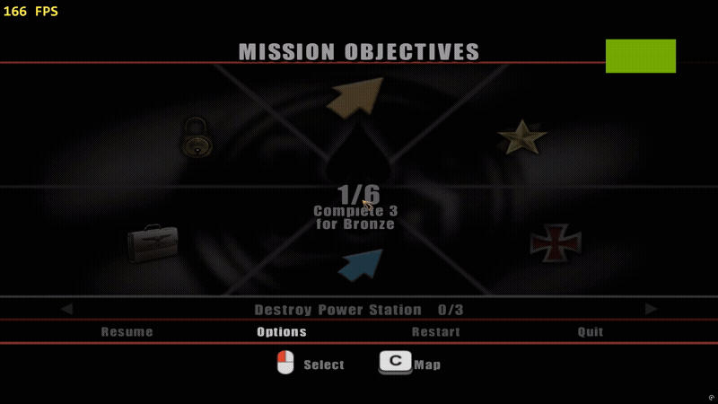
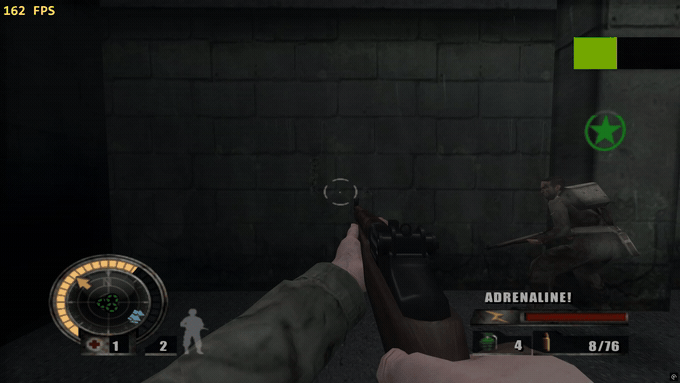
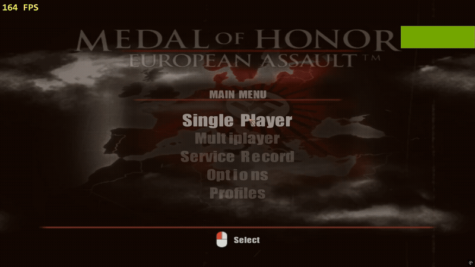

# Medal of Honor: European Assault — PC Port

**Version 0.9.1-beta** · Windows 10/11 64-bit · unofficial fan project, made with [Claude Code](https://claude.com/claude-code)

A native Windows port of *Medal of Honor: European Assault* (Xbox, USA / NTSC‑U), made by **statically
recompiling** the game's own program (`DEFAULT.XBE`) into a PC executable — this is not an emulator, the
game's own code runs as native x86‑64.

> Not affiliated with, endorsed by or sponsored by Electronic Arts. *Medal of Honor* and *European Assault*
> are trademarks of Electronic Arts Inc. **No game data is included in this download — you need your own
> copy of the game.**

**[⬇️ Download the latest release](../../releases/latest)** — see [Install](#install) below.

## What's new in 0.9.1-beta

### Faster — measured, same PC, same settings

A/B test of the 0.9.0-beta executable against this one (RTX 4060, 165 Hz cap, same level, same route):

| | 0.9.0-beta | 0.9.1-beta | change |
|---|---|---|---|
| Median frame rate | 131 fps | **161 fps** | +23% |
| Slowest 10% of the time | 89 fps | **145 fps** | **+63%** |
| Median 1% low | 94 fps | **107 fps** | +14% |

In the heaviest places of the author's test (where 0.9.0 dipped to 80–125 fps) the new build stays above 150.
Gains depend on your PC; the busiest scenes gain the most. What changed inside:

- The whole game code is built with **profile-guided optimisation**, trained on real play.
- The cached **register and memory base addresses** are loaded once per function instead of before almost every memory
  access, in all 21,741 recompiled functions.
- The **game thread gets priority** in the emulated CPU lock: a worker no longer holds it for milliseconds (waits fell
  from 5–6 ms to under 1 ms per frame).
- Environment-variable lookups answered from a per-thread cache (they were hit on every frame).
- A **hitch watchdog** and a per-second `[FRAMES]` line in `play_log.txt` (frame times, lock waits) so a stutter can be
  traced from a bug report.
- The developer diagnostics (AI probes, shot and projectile logs, aim measurement) are **compiled out** of the player
  build, so they cannot cost a frame.

### Gameplay fixes

- **Karabiner 98k (and the whole fast-rifle class) now hits what the crosshair is on at 60 fps and above.** At high
  frame rates the game dropped the camera-kick term from the bullet's direction, so the bullet left about 2° too high
  and passed over enemies at range, while at 30 fps it was fine. The direction is now the same at every frame rate.
  It applies to the player's bullets with a fast muzzle speed (the Karabiner and rifles that share its class), not
  to machine guns or pistols. `RECOMP_AIM_FIX=0` turns it off.
- **Weapon mods:** the scanner no longer reads `mods\weapons\README.txt` as if it were a weapon file.
- **Grenade timer** (new, on by default, switchable): a small circle at the side of the screen counts down the seconds
  from the moment a grenade's pin is pulled or it is thrown.

### New options (in the launcher and in the in-game Recomp Settings, English and Arabic)

- **Enemy count (heavy, experimental)** — x2 to x5 times the enemies that spawn points create (reinforcements and
  respawns). Takes effect at the next mission load, can cost frames, and can be turned on or off **per difficulty**
  (Recruit, Veteran, Elite, Hero) with four extra switches.
- **Stamina bar** — a yellow sprint bar above the adrenaline meter that drains while you run; when it is empty you
  return to walking speed and it refills after a few seconds. Sprint speed, duration and recovery time are options.
- **Blood colour** — Original / Crimson (the new default) / Dark red / **Custom** with Hue, Saturation and Brightness
  rows and a colour square. The on-screen splatters keep their own colour.
- **Model detail** (level of detail for every model by distance): Game (the original) / Higher / Highest. Higher and
  Highest draw the better models farther away, so they can cost frames.
- **Replaced textures** — On/Off **while playing**, to compare the game's pictures with yours instantly.
- **Dump textures** is now Off / PNG / **DDS**. DDS replacements are read by the port itself (uncompressed 24/32-bit
  and DXT1/3/5, old or DX10 header).
- **Rain master switch** — *Rain* (default **Off**); while it is off, the other four rain rows stay visible but greyed
  out. With it on, the default strength is Normal. Fog stays as the game has it.
- **Screen rain** default is now Off in the shipped settings.
- **Split-screen pads (experimental, local multiplayer)** — with it on, the keyboard and mouse control player 1 alone and
  each gamepad drives the next player (game ports 2 to 4), so the game's own multiplayer menu can be used on one PC.
  Not yet verified that every mode then shows a split view; there is no online or LAN play (the original has no
  network code). Off by default; takes effect after a restart.
- **Keep corpses (experimental, off)** — bodies stay on the ground. Soldiers may freeze or respawn doubled with it on.

### In-game menu and files

- **F1 opens Recomp Settings during play** and the game keeps running behind it. The panel is a window (62% × 78% of the
  game window) instead of a full-screen takeover; F1 or gamepad Y reopens it at once after closing. The pause menu is
  untouched. While the panel is up the game gets no input, and held keys are released when it closes.
- **Saves and the Xbox partition images now live in `xboxdata\`** next to the game instead of 4–5 GB of sparse files
  under `%LOCALAPPDATA%\xboxrecomp`. Old saves are copied over once (the old folder is left alone).
- The **menu language** of Recomp Settings follows the game language (English / Arabic).

### AI and difficulty tuning (text files, no game files)

- **`mods\ai\tuning.txt`**: per-difficulty **player max health**, **revives** (medkits) and **enemy damage**
  (`MaxHealth.Recruit/Veteran/Elite/Hero`, `Revives.*`, `EnemyDamage`), plus `EnemyCount`. See `mods\ai\README.txt`.
- **`mods\ai\defs.txt`**: override or scale any of the game's named float / int definition fields by name (CRC32 of
  the name) or hash, optionally for one call site only.
- Research notes shipped in the README of that folder: in this game the difficulty setting changes **only the player**
  (health 400/200/100/50, revives 2/1/0/0); enemy accuracy, reaction time and sight range are **not** exposed there.

### Open source

- The port's **source code is published** in [`source/`](source/) under the MIT licence: the port code, the launcher,
  the in-game settings screen, the tools used to find things in the game, and the xboxrecomp toolkit with this port's
  changes. The recompiled game code itself (machine-translated EA code) is not included; `gen_hand_edits.txt` lists every
  hand edit made in it. See [source/README.md](source/README.md).

### Other

- The launcher shows version 0.9.1-beta and compares itself with the newest GitHub release.
- The shipped `recomp_settings.ini` defaults: rain off, everything else as before.

## Features

Read **[the full development story](PROJECT_STORY.md)** for how each of these was actually built — what
worked, what didn't, and the detours in between.

### Direct3D 11 rendering — widescreen, 4K, wider view, longer draw distance
Native 16:9, any resolution up to 4K, FXAA, anisotropic filtering — plus a field of view and a draw distance
far beyond the Xbox original, both adjustable live.

### Mouse and keyboard with native aim, auto-switching button icons
Native mouse-look (not a converted controller stick), full key rebinding, gamepad with rumble, and on-screen
prompts that switch automatically between keyboard, Xbox and PlayStation glyphs.

 <a href="media/feature_controls.mp4">full-quality video</a>

### Sharper fonts
Every one of the game's 8 fonts (menus, HUD, subtitles) redrawn at a much higher resolution, same layout.

### More blood, on every hit
Blood amount, size and lifetime are adjustable (Normal/More/Lots/Extreme).

### Screen blood, dirt and rain
Optional effects drawn on the screen itself: blood/dirt from a nearby hit or explosion, and rain drops in
St. Nazaire's weather levels.

  
  

### "Super Accuracy" — zero weapon spread, no recoil climb
An optional, honest toggle for players who want a steadier aim.

 <a href="media/feature_accuracy.mp4">full-quality video</a>

### Mod support — textures, sounds, weapon stats
Drop a PNG into `mods\textures`, a WAV into `mods\sounds`, or a text file into `mods\weapons` — no game
files are shipped, every player builds their own from their own copy.

### A full Arabic language pack, mirrored right-to-left menus
Including a fully Arabic, mirrored version of this project's own settings screen.

### A launcher (English + Arabic) with setup checks and presets
Checks your game files and system, performance presets, in-launcher key binding, save backup, update check.

  
  

### In-game "Recomp Settings" menu (F1) and F12 screenshots
Every setting above, changeable without leaving the game.

 <a href="media/feature_recompsettings.mp4">full-quality video</a>

## Please know (current limitations)

- Only the **USA / NTSC‑U** version of the game is supported.
- 60 to 165 fps now run well on the author's PC (RTX 4060); 240 fps and weaker PCs may still stutter in busy scenes. If
  a mode stutters for you, pick a lower one and send `play_log.txt` (it holds frame-time lines).
- Sound may **rarely** cut out in very long sessions; a guard restarts it automatically, but if it doesn't,
  please attach `play_log.txt` to an issue.
- Weapon mods: only a weapon's magazine size is confirmed to work; damage, range and fire-rate keys are
  shipped but **experimental**. Enemy count (x2 to x5) is experimental and heavy: it can cost frames.
- Sound replacement mods are shipped but **untested end‑to‑end**.
- The Arabic translation is partial; some mission subtitles stay in English or can clip in narrow boxes.
- Full list: [KNOWN_ISSUES.txt](KNOWN_ISSUES.txt).

## Install

1. Download the zip from **[Releases](../../releases/latest)** and unzip it anywhere you can write to
   (not `Program Files`).
2. Put your own copy of the game's files into the **`game`** folder: `game\DEFAULT.XBE`, `game\DATA\...`
   and `game\EAGLRM.O`. If you only have a disc image, unpack it with
   [xdvdfs](https://github.com/antangelo/xdvdfs) or any Xbox ISO extractor.
3. Run **`Launcher.exe`**. The *Play* tab shows green checks once everything is found. Pick your settings
   and press **PLAY**.
4. The very first start (and every new area) compiles shaders — short stutters are normal and go away.

You can also start `MOHEuropeanAssault.exe` directly; it reads the same settings the launcher writes.

## Reporting a problem

Please open an [issue](../../issues/new) (or use the launcher's **Report a problem** button, which opens
this page and the game folder for you) and attach `play_log.txt` (and `play_log_prev.txt`). Say which
Windows version and GPU you have. Windows SmartScreen or an antivirus may warn about the unsigned
executables — that is expected for a small unsigned project, not a sign of a problem.

## Credits

- *Medal of Honor: European Assault* © Electronic Arts. No EA game assets, other than files you supply
  yourself, are included in this repository or its release downloads.
- **[xboxrecomp](https://github.com/sp00nznet/xboxrecomp)** by sp00nz (MIT) — the static‑recompilation
  toolkit this whole project is built on.
- **[xemu](https://github.com/xemu-project/xemu)** (LGPL‑2.1+; espes, Jannik Vogel, Matt Borgerson and
  contributors) — the original‑Xbox audio/graphics chip emulation this port's sound and video code is
  derived from. Source of the derived files: see [SOURCE.txt](SOURCE.txt).
- **[xdvdfs](https://github.com/antangelo/xdvdfs)** by antangelo — unpacking the Xbox disc image.
- **[vgmstream](https://github.com/vgmstream/vgmstream)** — used as a development/verification tool only.
- Written and debugged together with **[Claude Code](https://claude.com/claude-code)** (Anthropic), which
  wrote and reverse‑engineered most of this port's code interactively with the author.
- Microsoft DirectX 11, XAudio2, GDI+.

## License

The **source code** ([`source/`](source/)) is under the MIT licence ([source/LICENSE-PORT.txt](source/LICENSE-PORT.txt)); the
download package is free for personal, non-commercial use, shared unchanged and with all credits (see
[LICENSE.txt](LICENSE.txt)). The LGPL-covered parts are listed in [SOURCE.txt](SOURCE.txt). The recompiled game code is
not published.